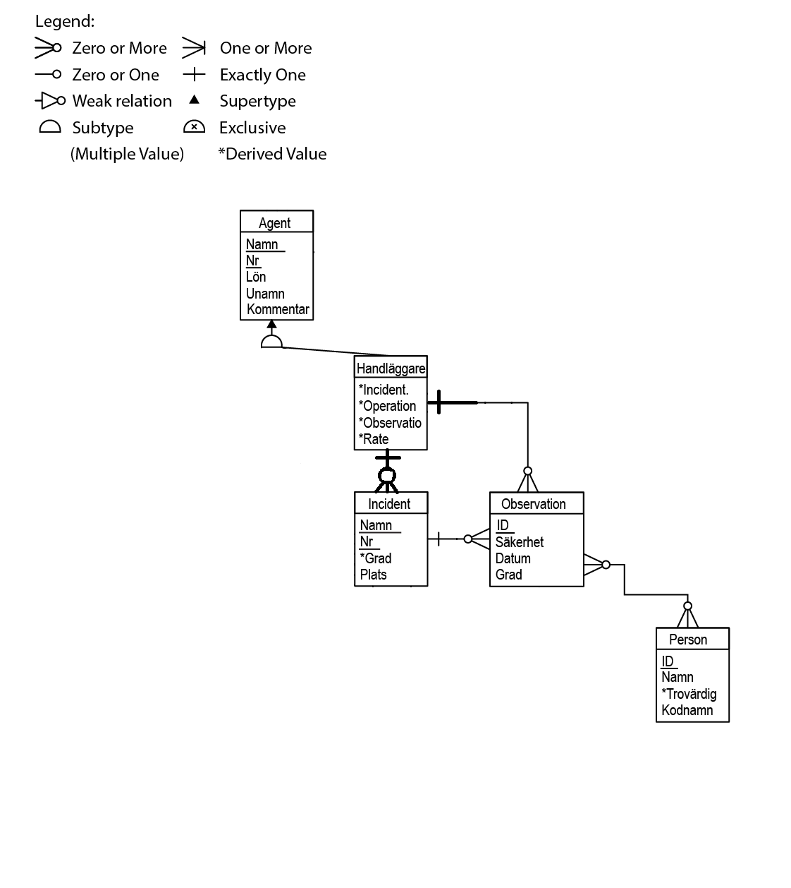

# Databaskonstruktion-Assignment-1-Startup

Startup code for first assignment in Databaskonstruktion

Här börjar jag med första delen av uppgiften.

# Overview
Jag har tilldelats Variant E: Handläggare. Min implementation fokuserar på de delar av systemet som hanterar registrering av observationer, de incidenter de tillhör samt personerna som rapporterar dem.

## ER-diagram

# Requirements
Här samlas alla verksamhetskrav och begränsningar från uppgiftsspecifikationen som är relevanta för mina fyra utvalda entiteter.

## Agent / Handläggare
* En agent identifieras unikt av ett namn (en bokstav) och ett nummer (t.ex. J 2).
* Agentens levnadsfilosofi lagras som en kommentar.
* Agentens lön samt ursprungliga förnamn och efternamn ska lagras.
* Det ska vara möjligt att beräkna:
  * Antalet incidenter som handläggaren rapporterat.
  * Antalet observationer som rapporterats av handläggaren.
  * Antalet operationer som startats på grund av incidenter rapporterade av handläggaren.
  * Procentandelen av handläggarens incidenter som lett till en operation.
* Lönegränser: En agent får inte tjäna mindre än 12 000 kr. Eftersom handläggare inte är gruppledare är deras lönetak 25 000 kr.
* Om ingen lön anges ska den automatiskt sättas till standardlönen 13 000 kr.
* Agentnumret får inte vara mindre än 0 och inte över 99. Numret får inte vara 0 (endast gruppledare får ha 0).
* Talet 13 är inte tillåtet som agentnamn.
* Om ett härlett värde som beräknar ett antal (t.ex. antal operationer) blir noll, ska texten "Inga operationer" visas i applikationen.

## Incident
* En incident identifieras unikt av antingen ett unikt namn eller ett unikt nummer.
* Platsen (platsbeskrivning/ort) där incidenten inträffade ska lagras.
* Incidenten måste inträffa i en region.
* Det ska gå att beräkna ett medelvärde på alla tillhörande observationers grad.
* Varje incident måste vara kopplad till den specifika handläggare som rapporterade den.

## Observation
* En observation kan gälla antingen ett rymdskepp eller en rymdvarelse (separata observationer skapas om båda siktats samtidigt).
* För varje observation måste datum, närkontaktsgrad samt säkerhet anges.
* Graden (närkontakt) måste vara ett heltal mellan 1 och 4 (där 4 innebär extrem närkontakt).
* Säkerheten anges i procent och får inte vara mindre än 1 % och inte högre än 114 %.
* För observation av rymdvarelser lagras: färg, kläder (generellt omdöme, ett par ord), typ (t.ex. humanoid) och storlek i meter.
* För observation av rymdskepp lagras: skeppets form, typ av lampor, färg samt en uppskattning av rörelsen.
* Varje observation måste ha lagrats av en handläggare och måste tillhöra en inträffad incident.
* Databasadministratörer ska kunna radera observationer vid mörkläggning, vilket även ska ta bort kopplingar till personer och handläggare.

## Person
* Varje person identifieras unikt av sitt personnummer eller (om personen vill vara anonym) ett automatgenererat nummer.
* Personens namn eller alias (om anonym) lagras som en textsträng.
* Ett eventuellt hemligt kodnamn ska kunna lagras.
* Det ska gå att beräkna personens trovärdighet baserat på om personens rapporterade observationer har varit säkra och om de har lett till lyckade operationer.
* Personer utan kodnamn eller som lämnat falska/inga namn antas vara mindre trovärdiga.

# Relations
Här översätts ER-diagrammet till logiska relationer med understrukna primärnycklar och genomstrukna främmande nycklar.

**Agent**(<ins>AgentNamn, AgentNr</ins>, Fornamn, Efternamn, Lon, Kommentar)

**Handlaggare**(<ins>~AgentNamn, AgentNr~</ins>)

**Incident**(<ins>IncidentId</ins>, Namn, Plats, ~RapportorNamn, RapportorNr~)

**Observation**(<ins>ObsId</ins>, Datum, Grad, Sakerhet, ~IncidentId~, ~RegistreradAvNamn, RegistreradAvNr~)

**Person**(<ins>PersonId</ins>, Namn, Kodnamn)

**Rapporterat**(<ins>~PersonId~,~ObsId~</ins>)

4. Fysisk Databasdesign

Denormalisering
För att möta verksamhetens krav på extremt snabb åtkomst vid pågående larm har databasen denormaliserats i fem steg:

1. **Table Merging (Slå ihop Incident + Observation):**
   * *Beslut:* Fälten `IncidentNamn` och `Plats` har slagits ihop direkt i `Observation`-tabellen för att eliminera dyra `JOIN`-frågor när handläggare söker observationer vid inkommande samtal.
2. **Kodifiering 1 (Plats):**
   * *Beslut:* Skapat kodtabellen `Plats` (`PlatsKod`, `PlatsNamn`). Textsträngar ersätts med `INTEGER` i `Observation` för att spara utrymme och snabba upp indexering.
3. **Kodifiering 2 (GradBeskrivning):**
   * *Beslut:* Skapat kodtabellen `GradBeskrivning` (`GradKod`, `Beskrivning`) för att standardisera förklaringarna av närkontaktsgrader.
4. **Horisontell Denormalisering (Horizontal Split):**
   * *Beslut:* Den stora textkolumnen `Kommentar VARCHAR(1024)` i `Agent` lyftes ut till en separat tabell `AgentKommentar`. Detta håller huvudtabellen `Agent` extremt kompakt i minnet.
5. **Vertikal Denormalisering (Vertical Split):**
   * *Beslut:* Skapat tabellen `ARKIVERADObservation` parallellt med `Observation`. Mörklagda/arkiverade observationer separeras från aktiva observationer, vilket avsevärt minskar datamängden vid frekventa realtidssökningar.
6. **Arvsrelation:**
   * *Beslut:* Arvsrelationen `Agent` ➔ `Handlaggare` lämnades orörd i enlighet med gällande regler mot denormalisering över arv.

Indexering
* **`OBSDATUM` (`CREATE INDEX OBSDATUM ON Observation(Datum DESC) USING BTREE;`):** Snabbar upp sökningar och sorteringar där handläggare visar de senast inkomna observationerna i kronologisk ordning.
* **`PERSONNAMN` (`CREATE INDEX PERSONNAMN ON Person(Namn ASC) USING BTREE;`):** Optimerar uppslagningar och alfabetisk sortering av vittnen och rapportörer.

Rättigheter (Access Control)
* Användarkonto: `'handlaggare_app'@'%'`.
* `GRANT SELECT, INSERT ON a25milha.Observation` tillåter handläggare att söka samt registrera nya larm.
* `GRANT SELECT ON a25milha.Person` ger läsrättighet till vittnesregistret.
* `REVOKE DELETE ON a25milha.Agent` förhindrar handläggarappen från att radera agenter ur systemet.

5. Beskrivning av Procedurer & Triggers

* **Trigger `LOGGOBSERVATION` (Loggning):**
  Varje gång en ny observation registreras i `Observation` skapar denna trigger automatiskt en post i `ObservationLog` med händelsen (`INS`), användarnamnet (`USER()`), observationens ID och exakt tidpunkt (`NOW()`). Detta säkerställer fullständig spårbarhet och säkerhet för myndighetens internkontroll.

* **Trigger `CHECKOBSGRAD` (Constraint/Regelkontroll):**
  Kontrollerar före införande (`BEFORE INSERT`) att närkontaktsgraden ligger inom det tillåtna intervallet 1 till 4. Om ett felaktigt värde matas in avbryts registreringen direkt och returnerar ett anpassat felmeddelande via `SIGNAL SQLSTATE '45000'`, vilket förhindrar korrupt data i databasen.

* **Procedur `GETAVGSAKERHET` (Funktion/Beräkning):**
  Beräknar och returnerar medelvärdet för säkerhetsprocenten (`AVG(Sakerhet)`) över alla registrerade observationer i databasen. Proceduren ger ledningen och handläggarna en snabb övergripande statistisk sammanställning av trovärdigheten i inkomna observationer utan att behöva skriva manuella SQL-frågor.

* **Procedur `ARKIVERAOBSERVATION` (Flytt/Materialisering):**
  Hanterar intern mörkläggning/arkivering av en valfri observation baserat på dess `ObsId`. Proceduren kopierar raden till tabellen `ARKIVERADObservation` (vertikal denormalisering) och raderar den därefter från aktiva observationer, vilket upprätthåller hög prestanda i huvudtabellen.
